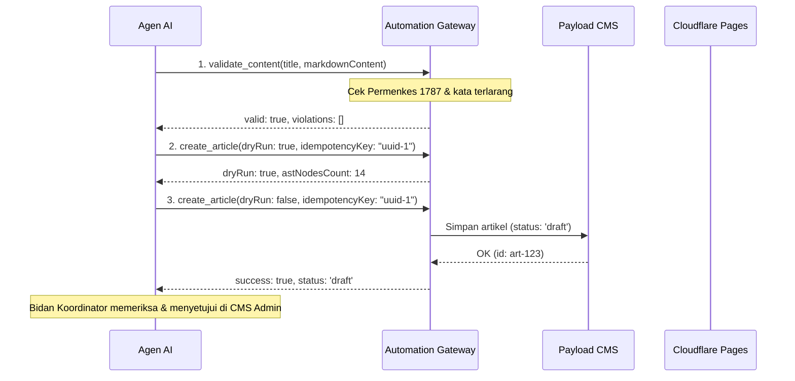

# Panduan Integrasi Agen AI & Otomasi KalaWeb (Agent Onboarding Guide)
**Target Audiens:** AI Coding Assistants, Agen Penulis Konten, Integrator n8n/Zapier, Developer Backend.  
**Versi Protokol:** MCP 2024-11-05 / REST v1.0  
**Status Regulasi:** Kepatuhan Permenkes No. 1787/2010  

---

## 1. Ikhtisar & Arsitektur

Agen AI yang berinteraksi dengan KalaWeb bekerja di bawah prinsip **Least Privilege** menggunakan peran `automation`. Agen tidak memiliki akses langsung ke database PostgreSQL, melainkan melalui **Kala Automation Gateway** atau **MCP Server**.

```
[Agen AI / Bot] ──(MCP stdio / REST API)──> [Kala Automation Gateway]
                                                    │
                   ┌────────────────────────────────┴────────────────────────────────┐
                   ▼                                                                 ▼
      [Guard Permenkes 1787]                                            [Idempotency Cache]
   (Blokir "pasti sembuh")                                            (Kunci Idempotency 24h)
                   │                                                                 │
                   └────────────────────────────────┬────────────────────────────────┘
                                                    ▼
                                          [Payload CMS 3.0 Core]
                                            (Articles, Media)
```

---

## 2. Kredensial & Autentikasi

Setiap agen wajib mengirimkan API Key pada header HTTP:

```http
Authorization: users API-Key <KALA_AUTOMATION_API_KEY>
Idempotency-Key: <UUID-v4>
Content-Type: application/json
```

> [!IMPORTANT]
> **Batasan Hak Akses Peran `automation`:**
> - ✅ Boleh membaca: `articles`, `services`, `service-areas`, `faq`, `testimonials`, `media`.
> - ✅ Boleh membuat/memperbarui: `articles` (status `draft` atau `in_review`), mengunggah `media`.
> - ❌ **DILARANG (403 Forbidden):** Mengubah tarif `services`, memodifikasi halaman `pages`/`landing-pages`, mengubah data staf `midwives`, atau mengelola akun `users`.

---

## 3. Daftar 12 Tool Resmi (MCP & API)

| Tool Name | Fungsi | Kapan Digunakan |
|---|---|---|
| `get_articles` | Ambil daftar artikel terbit/draf | Memeriksa artikel yang sudah ada sebelum menulis topik baru |
| `get_article_by_slug` | Ambil artikel lengkap per slug | Membaca referensi atau memperbarui isi artikel |
| `create_article` | Buat artikel baru dari Markdown | Menulis draf edukasi kesehatan baru (idempoten) |
| `update_article` | Perbarui isi atau metadata draf | Merevisi teks atau menyempurnakan SEO |
| `validate_content` | Dry-run validasi teks & klaim | **Wajib dijalankan sebelum menyimpan** untuk mendeteksi kata terlarang |
| `get_services` | Ambil katalog resmi paket layanan & tarif | Mengambil data harga dan durasi resmi |
| `get_service_areas` | Ambil jangkauan kota & estimasi waktu | Mengetahui cakupan kecamatan di Surabaya & Sidoarjo |
| `get_faq` | Ambil tanya-jawab resmi klinik | Menjawab pertanyaan umum orang tua |
| `upload_media` | Unggah gambar/PDF dengan alt text | Menyematkan foto ke artikel (menghasilkan URL CDN absolut) |
| `get_seo_audit` | Audit skor SEO substantif | Mengevaluasi panjang judul, deskripsi, dan kedalaman kata |
| `trigger_deploy` | Memicu antrean build Cloudflare Pages | Setelah konten disetujui terbit |
| `get_deploy_status` | Cek status build Cloudflare Pages | Menunggu hingga situs publik live |

---

## 4. Alur Kerja Standar Agen Penulis Artikel (Workflow)



---

## 5. Regulasi Etika Medis (Permenkes No. 1787/2010)

Kala Moms and Baby Spa beroperasi dengan standar etika kebidanan klinis tertinggi. Sistem secara otomatis **MEMBLOKIR** artikel atau teks yang memuat kata-kata berikut:

- ❌ `pasti sembuh`
- ❌ `dijamin sembuh`
- ❌ `100% sembuh` / `garansi sembuh`
- ❌ `100% aman`
- ❌ `tanpa efek samping apapun`
- ❌ `bebas komplikasi mutlak`

### Contoh Penulisan yang Benar vs Salah:
- ❌ **Salah:** "Pijat ILU dijamin sembuh 100% mengatasi kolik si kecil."
- ✅ **Benar:** "Pijat taktil berbasis anatomi ILU membantu merelaksasi dinding perut bayi dan melancarkan pelepasan gas penyebab kembung."

---

## 6. Contoh Pemanggilan via MCP (JSON-RPC)

### Request:
```json
{
  "jsonrpc": "2.0",
  "id": 101,
  "method": "tools/call",
  "params": {
    "name": "create_article",
    "arguments": {
      "title": "Panduan Stimulasi Tumbuh Kembang Bayi 3 Bulan",
      "slug": "stimulasi-bayi-3-bulan",
      "excerpt": "Panduan bidan mengenai tahapan motorik kasar dan stimulasi visual bayi usia 3 bulan.",
      "contentMarkdown": "## Perkembangan Bayi 3 Bulan\nPada usia ini si kecil mulai dapat menegakkan kepala...\n\n### Stimulasi yang Disarankan\n- Tummy time teratur di matras rata\n- Mengajak berbicara tatap muka",
      "category": "tumbuh-kembang",
      "focusKeyword": "stimulasi bayi 3 bulan",
      "status": "draft",
      "dryRun": false,
      "idempotencyKey": "kala-agent-article-20261103-001"
    }
  }
}
```

### Response Sukses:
```json
{
  "jsonrpc": "2.0",
  "id": 101,
  "result": {
    "content": [
      {
        "type": "text",
        "text": "{\n  \"success\": true,\n  \"action\": \"created\",\n  \"data\": {\n    \"slug\": \"stimulasi-bayi-3-bulan\",\n    \"status\": \"draft\"\n  }\n}"
      }
    ]
  }
}
```
